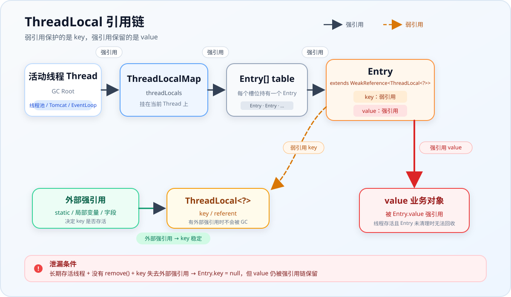

# ThreadLocal 内存泄漏与引用链

## 一句话结论

ThreadLocal 泄漏的本质不是“弱引用导致泄漏”，而是**生命周期错配**：

`ThreadLocalMap` 挂在 `Thread` 上，`Entry` 对 `value` 是强引用。当线程长期存活，而业务代码没有调用 `remove()` 时，`value` 的生命周期就被绑定到了线程上，无法随请求或任务结束而释放。

弱引用只会让不再被外部强引用的 `ThreadLocal` key 变成 `null`，不会自动释放仍被 `Entry` 强引用的 `value`。

## 数据结构与引用链

线程通过 `threadLocals` 持有自己的 `ThreadLocalMap`：

```java
Thread
  └─ threadLocals: ThreadLocal.ThreadLocalMap
       └─ table: Entry[]
            └─ Entry extends WeakReference<ThreadLocal<?>>
                 ├─ key/referent: ThreadLocal<?>  // 弱引用
                 └─ value: Object                 // 强引用
```

完整引用路径如下：



`new ThreadLocal<>()` 创建的是堆上的对象，代码中的 `tl` 只是指向它的引用。多个线程使用同一个 `static final ThreadLocal` 时，每个线程的 `ThreadLocalMap` 中的 key 都弱引用同一个 `ThreadLocal` 实例，而各自维护独立的 value。线程隔离来自“每个线程一个 Map、每个 Map 一个 value”，并不要求每个线程创建不同的 key。

因此，`ThreadLocal` 对象是否存活，主要看**是否还有外部强引用**；`value` 是否释放，则取决于**线程、Map、Entry 是否继续存活，以及是否执行了 `remove()`**。

## 泄漏是如何发生的

典型条件如下：

1. 使用线程池、Tomcat 工作线程、Netty EventLoop 等长期存活的线程；
2. 通过 `ThreadLocal#set()` 放入了较大对象或其他需要及时释放的数据；
3. 任务结束后没有调用 `ThreadLocal#remove()`；
4. `ThreadLocal` 实例失去外部强引用后，GC 清空了 `Entry` 的弱引用 key。

此时 `Entry` 会变成：

```text
Entry.key = null
Entry.value = 仍然被强引用的大对象
```

从业务上看，原来的 `ThreadLocal` 已经无法访问，这个 value 已经没有用处；但从 GC 角度看，仍然存在完整强引用链：

```text
Thread -> ThreadLocalMap -> Entry -> value
```

只要线程还活着，GC 就不会回收这个 value。这就是经典的 ThreadLocal 内存泄漏。

普通线程结束后，`ThreadLocalMap` 会随线程一起回收，通常不会造成长期泄漏；问题主要出现在线程被复用的场景。

## 弱引用 key 会被 GC 误删吗

不会。`WeakReference` 并不是“每次 GC 都无条件清空”，而是：

> 当被引用对象只剩弱引用可达，没有强引用、软引用等更强引用时，GC 才可能清除这个弱引用。

只要同一个 `ThreadLocal` 实例仍然被强引用，`Entry.key` 就不会因为 GC 被清空：

```java
private static final ThreadLocal<String> TL = new ThreadLocal<>();

TL.set("abc");
System.gc();

// TL 仍然强引用 ThreadLocal 对象，key 不会被清除
System.out.println(TL.get()); // abc
```

`System.gc()` 只是建议 JVM 执行 GC，并不保证立即执行；这里的关键不在于某次 GC 的时机，而在于 `TL` 一直是 `ThreadLocal` 对象的强引用。

反过来，如果能够继续调用 `threadLocal.get()`，通常说明当前代码仍然持有该 `ThreadLocal` 实例的强引用。因此不会出现“同一个 ThreadLocal 先 get 有值，GC 后再次 get 就没值”的情况。

只有当 `ThreadLocal` 对象不再被外部强引用时，key 才可能被 GC 清空，例如：

```java
void foo() {
    ThreadLocal<String> tl = new ThreadLocal<>();
    tl.set("abc");
}
// 方法结束后，若没有其他地方强引用 tl，
// ThreadLocal 对象就可能被 GC，Entry.key 变成 null
```

这时也无法再通过原来的 `tl` 调用 `get()`。key 被清空并不等于 ThreadLocalMap 主动删除了 Entry；GC 只负责清空弱引用，stale Entry 仍可能留在 table 中。

## key 与 value 的区别

| 对比项 | key：ThreadLocal 对象 | value：业务对象 |
|---|---|---|
| Entry 中的引用方式 | 弱引用 | 强引用 |
| 主要路径 | `Thread -> Map -> Entry --弱引用--> ThreadLocal` | `Thread -> Map -> Entry --强引用--> value` |
| 线程存活的影响 | 线程存活决定弱引用槽位是否存在，但不阻止 ThreadLocal 对象被回收 | 强依赖。线程长期存活会让 value 一直可达 |
| 外部强引用的影响 | 有外部强引用时 key 不会被清；没有时可能被 GC 清空 | 基本无关，即使 ThreadLocal 已失联，value 仍可能在 Map 中存活 |
| 生命周期归属 | 由外部强引用决定 | 实际被绑定到线程生命周期 |
| 泄漏中的角色 | 通常不是泄漏主体 | 经典 ThreadLocal 泄漏的主要对象 |

## 为什么 value 不能也使用弱引用

key 只是“索引”，value 才是用户要保存的数据，二者不能采用同一种引用策略。

`ThreadLocal` 对象通常还有外部强引用，key 即使弱引用，正常使用时也不会消失。value 则可能只被 `ThreadLocalMap` 强引用：

```java
TL.set(new UserInfo());
UserInfo user = TL.get();
```

如果 Entry 也弱引用 value，`set()` 后没有任何外部强引用的 `UserInfo` 就可能在下一次 GC 时被回收，`get()` 随时返回 `null`，破坏“值在 `remove()` 或线程结束前保持可用”的语义。它没有解决泄漏，只是把“可能泄漏”换成了“可能丢数据”。

因此设计上必须由 Map 强引用 value：数据稳定存在由 `set()` 保证，结束使用后由 `remove()` 主动释放。

## 常见误区

### 弱引用导致内存泄漏

不对。弱引用让 key 在外部不再强引用时可以被回收，是为了减少 key 本身的残留；真正泄漏的是仍被 `Entry` 强引用的 value。

### 声明为 `static final` 就不会泄漏

不对。`static final` 只能让 key 长期稳定存在，避免产生 `key == null` 的 stale Entry，但不能替代 `remove()`。如果 value 一直不清理，线程池线程仍会长期持有它，还可能造成任务间的数据污染。

### GC 会自动删除 stale Entry

不完全对。GC 只清空弱引用，`ThreadLocalMap` 会在后续 `get()`、`set()`、`remove()` 时顺带清理部分 stale Entry。这种清理是惰性的，不保证及时覆盖所有槽位。

### 调用过 `get()` 或 `set()` 就会自动清理干净

不对。`expungeStaleEntry`、`cleanSomeSlots` 等逻辑属于防御性清理，只处理探测路径上的部分 stale Entry，不能替代显式 `remove()`。

### 取不到 value 一定是 GC 造成的

不一定。更常见的原因包括：

- 已经调用了 `remove()`；
- 设置了 `null`；
- 切换了线程，ThreadLocal 的值本来就按线程隔离；
- 使用了不同的 ThreadLocal 实例；
- 只通过 `WeakReference<ThreadLocal>` 持有 key；
- `InheritableThreadLocal` 与线程池复用方式不匹配。

## 正确用法

ThreadLocal 应声明为 `static final`，并在请求、任务或方法结束时通过 `finally` 清理：

```java
private static final ThreadLocal<RequestContext> CONTEXT = new ThreadLocal<>();

public void handle(Request request) {
    try {
        CONTEXT.set(new RequestContext(request));
        // 业务逻辑
    } finally {
        CONTEXT.remove();
    }
}
```

还要注意：

- 不要把大对象、缓存或长生命周期数据放进 ThreadLocal；
- 在线程池任务中尤其要清理，避免跨任务内存残留和数据污染；
- 不要依赖弱引用、GC 或框架的偶然清理；
- `static final` 负责稳定 key，`remove()` 负责释放 value，两者解决的是不同问题。

## 快速判断

排查 ThreadLocal 泄漏时，可以依次确认：

1. 是否使用了长期存活的线程；
2. ThreadLocal 是否保存了较大对象或上下文对象；
3. 所有执行路径是否都在 `finally` 中调用了 `remove()`；
4. 是否存在只创建 ThreadLocal、却没有保留统一实例的用法；
5. 线程复用后是否出现旧 value 残留或数据串扰。

最终可以记住：

> **弱引用保护的是 key，`remove()` 保护的才是 value。**
