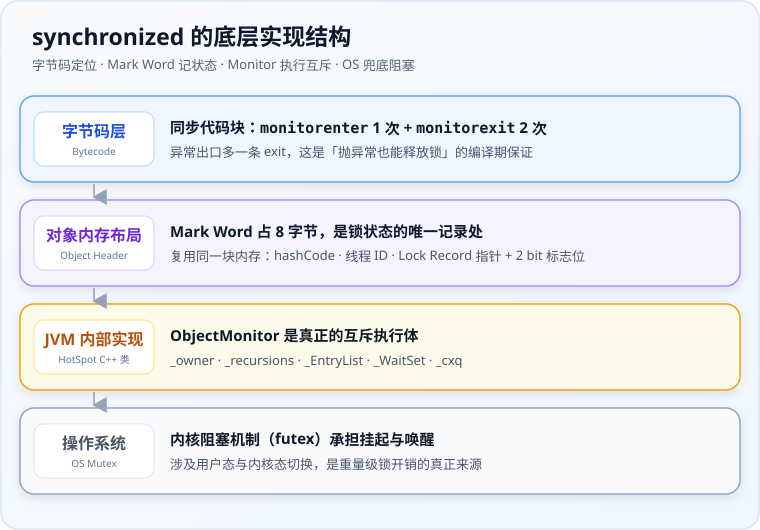
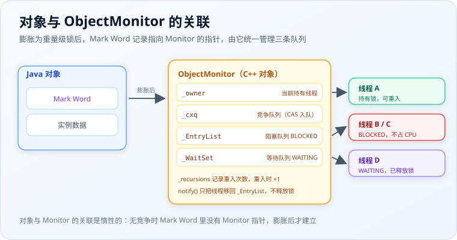
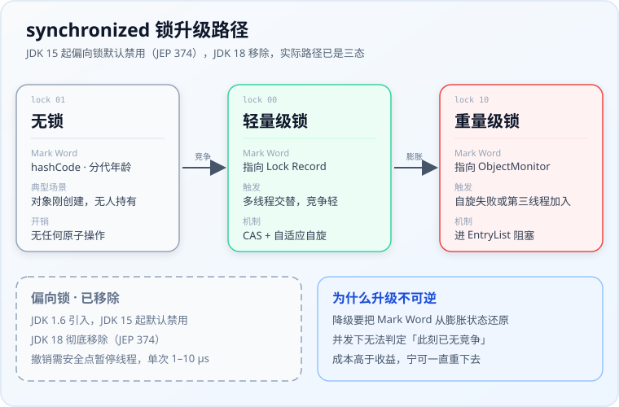

# synchronized 底层原理与锁升级

> 来源：同一会话中 synchronized 底层实现、对象头 Mark Word、ObjectMonitor 结构与锁升级相关问答整理。

## 一句话结论

synchronized 不是一个简单的关键字，而是四层机制的协作结果：



| 层次 | 承载物 | 职责 |
|---|---|---|
| 字节码层 | `monitorenter` / `monitorexit`、`ACC_SYNCHRONIZED` | 标记加锁解锁的位置 |
| 对象内存布局 | 对象头 Mark Word 中的标志位 | 记录当前锁处于什么状态 |
| JVM 内部实现 | C++ 类 `ObjectMonitor` | 真正的互斥执行体，维护等待队列 |
| 操作系统 | futex / Mutex | 线程阻塞与唤醒，唯一能"让出 CPU"的通道 |

一句话记法：**Mark Word 是状态寄存器，ObjectMonitor 是互斥执行体，锁升级是按需加压的策略，JIT 的锁消除锁粗化是编译期止损。**

## 一、字节码层：三种用法编译结果不同

### 同步代码块

编译器在同步块入口插入 `monitorenter`，在正常出口和异常出口**各插入一条** `monitorexit`：

```java
public void sync() {
    synchronized (this) {
        doSomething();
    }
}
```

反编译后大致为：

```text
monitorenter
... 同步块指令 ...
monitorexit      // 正常返回路径
...
monitorexit      // 异常返回路径（由编译器生成的异常表指向）
```

所以字节码里通常是 **1 个 monitorenter + 2 个 monitorexit**。这就是"synchronized 抛异常也能自动释放锁"的实现基础——是编译期在字节码层面织入的结构，不是运行时兜底。

### 同步方法

方法体里**一条锁指令都没有**，只在方法访问标志里多了 `ACC_SYNCHRONIZED`：

```text
public synchronized void method();
  flags: ACC_PUBLIC, ACC_SYNCHRONIZED
```

JVM 在方法调用入口检测到该标志就先获取 Monitor，方法结束（正常或异常）时自动释放。实例方法锁的是 `this`，静态方法锁的是当前类的 `Class` 对象。

> 常见陷阱：静态同步方法和实例同步方法**不互斥**，因为它们锁的是两个完全不同的对象（`Class` vs `this`）。

## 二、对象内存布局与 Mark Word

Java 对象在内存中分为三部分：对象头、实例数据、对齐填充。对象头里的 **Mark Word** 是 synchronized 的核心，它是一块复用内存——同一份 64 bit，锁状态不同存的内容完全不同。


以 64 位 JVM 为例：

| 锁状态 | Mark Word 存储内容 | 最后 2 bit（lock） |
|---|---|---|
| 无锁 | unused(25) + hashCode(31) + unused(1) + 分代年龄(4) + 偏向位(1) | `01` |
| 偏向锁 | 持有线程 ID(54) + epoch(2) + unused(1) + 分代年龄(4) + 偏向位(1) | `01`（偏向位为 1） |
| 轻量级锁 | 指向栈帧中 Lock Record 的指针（62 bit） | `00` |
| 重量级锁 | 指向 ObjectMonitor 的指针（62 bit） | `10` |
| GC 标记 | 空 | `11` |

锁升级的过程，本质上就是这 8 字节的内容和最后 2 bit 标志位不断变化的过程。

### hashCode 与偏向锁的位冲突

Mark Word 里 **hashCode 和偏向锁的线程 ID 抢同一块位置**，这带来两个推论：

1. 对象一旦调用过 `Object#hashCode()`（且未重写、走的是默认实现），就无法再进入偏向锁状态；
2. 从偏向锁膨胀到轻量级锁时，hashCode 不会丢失，而是被搬到当前线程栈上的 Displaced Mark Word 里保存；膨胀到重量级锁时则转移到 ObjectMonitor 中。

所以"调用了 hashCode 就再也不是偏向锁"是对的，但"hashCode 没了"是错的。

## 三、ObjectMonitor：真正的互斥执行体

每个 Java 对象都关联一个 Monitor（管程），HotSpot 中由 C++ 类 `ObjectMonitor` 实现。膨胀为重量级锁后，对象头 Mark Word 记录指向它的指针，由它统一管理线程的持有、阻塞与等待：



关键字段：

| 字段 | 含义 |
|---|---|
| `_owner` | 指向当前持有锁的线程 |
| `_recursions` | 重入次数，实现可重入性 |
| `_EntryList` | 阻塞队列，存放竞争锁失败的线程（BLOCKED 状态） |
| `_WaitSet` | 等待队列，存放调用 `wait()` 后释放锁的线程 |
| `_cxq` | 竞争队列，多线程争抢时先入此单向链表，再转移到 EntryList |

### Monitor 不在 Java 堆上

这一点很容易想当然。`ObjectMonitor` 是 HotSpot 用 C++ 定义的类，**分配在本地内存（CHeap），不在 GC 管理的 Java 堆里**：

- **不被 GC 感知**：它内部存的是操作系统线程指针和等待队列，不是 Java 引用，交给 GC 反而添乱；
- **地址必须稳定**：GC 会移动 Java 对象，如果 Monitor 在堆内，Mark Word 里的指针就得跟着一起改，代价太高；
- **懒分配 + 可复用**：只有膨胀时才从空闲池取一个（`ObjectSynchronizer::inflate`），锁释放后归还，并不是每个对象天生带一个 Monitor。

所以 Mark Word 到底指向谁，要分状态看：

| 锁状态 | Mark Word 存什么 | 指向的位置 |
|---|---|---|
| 偏向锁 | 持有线程 ID | 不指向任何结构 |
| 轻量级锁 | Lock Record 指针 | 当前线程的**栈帧**（随栈帧一起消失） |
| 重量级锁 | ObjectMonitor 指针 | **本地内存（CHeap）**，非堆 |

"每个对象都关联一个 Monitor"这句话的真实含义是：**逻辑上关联，物理上按需创建**。

### 加锁与释放流程

线程执行 `monitorenter` 时逻辑简化如下：

1. `_owner` 为空（`_count == 0`）：把 `_owner` 设为当前线程，计数加 1，获取成功；
2. `_owner` 是当前线程自己：`_recursions` 加 1，**这就是可重入的来源**；
3. 被其他线程持有：先短暂自旋，失败后进入 `_cxq` / `_EntryList` 阻塞等待；
4. `monitorexit` 时递减计数，归零则释放锁，并按策略唤醒 `_EntryList` 中的线程。

### 为什么 wait/notify 必须在 synchronized 块中调用

因为 `wait()` / `notify()` 操作的就是 Monitor 的 `_WaitSet` 和 `_EntryList` 两个队列，**必须先持有 Monitor 才有资格操作这些队列**。否则会抛 `IllegalMonitorStateException`。

配套要知道的两件事：

- `wait()` 会释放锁并进入 `_WaitSet`；被 `notify()` 唤醒后回到 `_EntryList` **重新竞争**锁，而不是直接执行；
- `notify()` 本身**不会立刻释放锁**，必须等当前 synchronized 块执行完才释放。

### 可重入性

同一线程再次获取自己已持有的锁时，只需 `_recursions` 加 1，不产生任何竞争。所以递归调用同步方法不会死锁。

## 四、锁升级：四种状态的演进

JDK 1.6 之前 synchronized 直接对接操作系统的 Mutex Lock，每次加解锁都要用户态与内核态切换，开销极大。JDK 1.6 引入锁升级机制，根据竞争激烈程度渐进加压。

### 各状态对照

| 锁状态 | 适用场景 | 加锁方式 | 开销 |
|---|---|---|---|
| 偏向锁 | 始终只有一个线程访问 | 首次 CAS 写入线程 ID，之后只比对 ID | 极低，仅一次比对 |
| 轻量级锁 | 多线程交替获取，竞争不激烈 | 栈帧创建 Lock Record，CAS 将 Mark Word 替换为指向它的指针 | 低，CAS + 自旋 |
| 重量级锁 | 多线程同时竞争，自旋失败 | 依赖操作系统 Mutex，线程挂起 | 高，涉及内核态切换 |

JDK 15 之后的实际路径已经跳过偏向锁——上方三张实线卡片是当前路径，下方虚线框是已被移除的历史状态：



### 偏向锁

线程 A 第一次进入同步块时，CAS 把线程 ID 写入 Mark Word。之后 A 再进入只需比对 ID，**没有任何同步操作**。

当另一个线程 B 尝试获取该锁时，偏向状态被打破，触发偏向锁撤销——这需要在**安全点**暂停持有偏向锁的线程，然后升级为轻量级锁。撤销开销单次约 1–10 μs。

### 轻量级锁与自适应自旋

线程在自己的栈帧中分配 Lock Record，把对象头 Mark Word 复制过来（Displaced Mark Word），再 CAS 尝试把 Mark Word 替换为指向该 Lock Record 的指针。

CAS 失败说明有竞争，线程会**自适应自旋**：JVM 根据上一次在同一把锁上自旋的成功率动态调整次数——上次成功了就多转几圈，经常失败就少转甚至直接挂起。这不是固定次数。

自旋失败，或者第三个线程也来参与竞争，就膨胀为重量级锁，Mark Word 改为指向 ObjectMonitor。

### 为什么升级不可逆

升级是单向的。不是因为技术做不到降级，而是因为降级需要把 Mark Word 从膨胀状态还原，而并发下无法安全判定"此刻已经没有竞争了"——这个判定的成本高于收益。所以宁可让该对象的锁永远重下去。

## 五、偏向锁为什么被废弃

偏向锁在 **JDK 15 被标记废弃（JEP 374），默认禁用；JDK 18 中被彻底移除**。原因有三：

1. **并发模型变了**：偏向锁诞生于 2004 年，假设大多数锁无竞争且由单线程反复获取（典型如 Swing GUI）。现代服务端应用普遍使用线程池 + Web 容器，同一个对象会被不同线程轮流访问，偏向锁撤销极其频繁。
2. **撤销开销远大于收益**：撤销需要安全点 STW 级别配合，单次约 1–10 μs，而一次轻量级锁的 CAS 只有约 20 ns。多线程场景下偏向锁反而比直接用轻量级锁更慢。
3. **维护成本高**：相关代码散布在 HotSpot 多处，复杂度高，收益已不匹配代价。

因此在新版 JDK 中，实际路径变成了：

```text
无锁 → 轻量级锁 → 重量级锁
```

> 面试注意：如果目标 JDK 是 17 / 21，回答"锁升级是无锁→偏向→轻量→重量"会直接暴露是背旧资料。正确说法是"偏向锁已移除，当前是三态"，再补充旧版本背景。

## 六、JIT 层的两种优化

除了锁升级，JIT 还会基于逃逸分析做两件事：

- **锁消除**：逃逸分析发现对象不会被其他线程访问（如方法内的局部 `StringBuffer`），直接把 synchronized 操作去掉；
- **锁粗化**：连续多次对同一对象加锁解锁（如循环内反复 `append`），把锁范围扩大到整个序列外层，减少加锁次数。

所以"只有一个线程访问同步方法有开销吗"的答案是：现代 JDK 下是一次 CAS 的轻量级锁，如果对象不逃逸则直接为零。

## 七、内存语义：synchronized 如何保证可见性

JMM 规定：进入 synchronized 块时使工作内存失效，从主存重新读取共享变量；退出时把修改刷回主存。

对应 happens-before 规则是**监视器锁规则**：对一个锁的解锁 happens-before 于后续对同一个锁的加锁。

这也是双重检查锁（DCL）必须加 `volatile` 的原因：

```java
private static volatile Singleton instance;

public static Singleton getInstance() {
    if (instance == null) {
        synchronized (Singleton.class) {
            if (instance == null) {
                instance = new Singleton();
            }
        }
    }
    return instance;
}
```

`new Singleton()` 分为分配内存、初始化、引用赋值三步，后两步可能重排。synchronized 只保证临界区内串行执行，**管不住临界区内的写与临界区外的读之间的重排**，所以必须靠 volatile 禁止重排。

## 八、常见踩坑点

### 用常量或缓存对象当锁

```java
synchronized ("lock") { ... }        // 字符串常量池中全局唯一
synchronized (Integer.valueOf(1)) { } // Integer 缓存 -128~127 全局唯一
```

全 JVM 共享同一个对象，任何地方的同类代码都会互相阻塞，是隐蔽的死锁制造机。**永远不要用常量对象做锁。**

### 锁对象被替换

```java
private Object lock = new Object();

void foo() {
    synchronized (lock) {
        lock = new Object();   // 锁对象被换掉，互斥失效
    }
}
```

线程 A 持有旧对象锁时，线程 B 看到的已是新对象，互斥完全不生效。锁对象应声明为 `private final`。

### 子类重写同步方法

synchronized 不是方法签名的一部分，重写时不会自动继承。子类需要自己显式加。

### 构造方法不能加 synchronized

语法不允许。构造期间对象还没发布给其他线程，语义上也无意义。

### 不同实例的实例锁不互斥

`synchronized` 只保证**同一把锁**的互斥。多个 `new` 出来的实例各有一把实例锁，加在一起并不构成线程安全。

## 九、与 ReentrantLock 的对比

| 维度 | synchronized | ReentrantLock |
|---|---|---|
| 实现层次 | JVM 关键字 + Monitor | JDK API，基于 AQS |
| 释放方式 | 异常自动释放 | 必须手动 `unlock()`，建议放 finally |
| 可中断获取 | 不支持 | 支持 `lockInterruptibly()` |
| 超时获取 | 不支持 | 支持 `tryLock(timeout)` |
| 公平锁 | 不支持 | 支持 |
| 条件队列 | 单一 wait/notify | 多个 `Condition` |
| 可重入 | 支持 | 支持 |
| 性能 | JDK 6 后与 ReentrantLock 基本持平 | 同左 |

两者都是可重入的（常见陷阱题）。选择上：需要超时、可中断、公平或多条件队列时用 ReentrantLock，其余场景 synchronized 更简洁且不会忘记释放。

## 十、用户态、内核态与重量级锁的成本

这一节回答三个经常被混在一起的问题：CAS 到底要不要进内核？阻塞为什么必须进内核？"重"到底重在哪儿？

### 前提：内核不是"独立的执行者"

CPU 任何时刻只执行一段代码——要么是用户代码，要么是内核代码。特权级（x86 的 ring 3 / ring 0）只决定**当前这段代码有权执行哪一类指令**。

所谓"进入内核态"，不是把任务交给另一台机器，而是：CPU 把特权级从 ring 3 切到 ring 0，跳转到内核预设的入口地址，开始执行内核代码。

推论很重要：**"操作系统在旁边看着并帮你执行指令"这个画面并不存在**。内核只是内存里的一堆代码和数据结构，由同一颗 CPU 在更高特权级下执行。

### CAS 为什么不需要内核

- CAS 在 x86 上就是一条 `lock cmpxchg`，属于**非特权指令**，用户态代码可以直接执行；
- 原子性由**硬件**保证：`lock` 前缀锁定对应 cache line，靠 MESI 缓存一致性协议挡住其他核心的并发访问；
- 整个过程几十纳秒，没有模式切换，操作系统全程无感知。

所以轻量级锁、AQS 的 CAS、futex 的快路径，都在用户态完成。

### 阻塞为什么必须进内核

线程"睡着"意味着三件事：从调度器的就绪队列里移出去、让出 CPU、之后被唤醒放回队列。而**调度器和就绪队列都在内核里**——用户态代码既没权限把 CPU 让给谁，也没法把自己从等待队列上叫醒。

这里必须分清两个经常被混淆的东西：

| | 是什么 | 谁能用 |
|---|---|---|
| `syscall` 指令 | 一条**非特权**的陷阱指令，用户态就能执行，作用是"敲门" | 用户线程 |
| 特权指令（关中断、改页表、调度切换） | 内核干活时用的工具 | 只有 ring 0 下的内核代码 |

准确的说法是：**用户线程用非特权指令"请求"内核，内核用特权指令"完成"请求**。

所以说"重量级锁执行的是特权指令"是不对的——用户代码从头到尾没执行过一条特权指令，它只是执行了一条 `syscall`，由 CPU 硬件完成模式切换。

### 成本拆解：重量级锁重在哪

| 成本项 | 具体内容 | 量级 |
|---|---|---|
| 用户态 → 内核态 | syscall 入口、现场保存、参数校验 | 数百 ns |
| 线程上下文切换 | 保存 / 恢复寄存器、栈指针、地址空间状态 | 1–10 μs |
| 缓存与 TLB 污染 | 新线程冲掉 cache line，旧线程恢复后要重新预热 | 隐性但影响最大 |
| 调度延迟 | 唤醒 ≠ 立即执行，要排队等 CPU，时长完全不可控 | 微秒到毫秒 |
| Monitor 队列维护 | `_cxq` / `_EntryList` 的链表操作与唤醒策略 | 百 ns 级 |

量级对比：偏向锁约 1 ns，轻量级锁 CAS 约 10–50 ns，重量级锁阻塞 1–10 μs 起。

如果临界区本身只有 100 ns 的工作量，一次阻塞的成本就是它保护代码的 100 倍以上——**加锁的机器时间淹没了被保护的业务代码**，这才是"重"的本意，而不是"数据结构复杂"。

### 更精确：Linux 上是 futex，而且重量级锁不等于每次都进内核

HotSpot 在 Linux 上的阻塞，底层用的是 **futex**（fast userspace mutex），而不是某个"内核 Mutex 原语"。它用一个 32 位整数表示状态：`0` 无锁、`1` 已锁且无等待者、`2` 已锁且有等待者。

- **快路径**：用户态直接 CAS 抢锁，**完全不进内核**；
- **慢路径**：CAS 失败后先把状态改成 2，再调用 `futex(FUTEX_WAIT)` 进内核挂起；
- **释放**：状态改回 0，若发现之前是 2，调用 `futex(FUTEX_WAKE)` 唤醒一个等待者。

调用链大致是：

```text
ObjectMonitor::enter → os::PlatformMonitor::park
  → pthread_cond / futex → syscall 指令 → 内核 futex 处理 → 特权指令干活
```

所以即使已经膨胀成重量级锁，**无竞争时 `monitorenter` 仍然先走一次 CAS trylock，不会进内核**。重量级锁描述的是"最坏情况的上限"，不是每次调用的固定成本。

这也解释了为什么 JVM 的锁升级和 Linux 的 futex 长得一模一样——两者遵循同一个原则：**能用 CAS 解决就不进内核，必须阻塞时才付切换的代价**。

### 补充：对象头还在继续变小

JDK 24 引入的实验特性 JEP 450（Compact Object Headers，`-XX:+UseCompactObjectHeaders`）把对象头从 96 / 128 bit 压到 64 bit。压缩后一块字长装不下 hashCode 和指针，于是改用块寻址加一层间接引用来回取原 Mark Word，OpenJDK 称之为 "overwritten Mark Word"。

底层逻辑没变：Mark Word 始终是一块**被动态解释的 tagged 区域**，而不是固定语义的字段集合。

## 十一、面试追问链

面试官最常用的追问链是这一条，能一路问 20 分钟：

```text
三种用法（锁 this / 锁 Class / 锁指定对象）
  → 底层 monitorenter / ACC_SYNCHRONIZED
    → 对象头 Mark Word 四个状态
      → ObjectMonitor 的 _owner / _EntryList / _WaitSet
        → 锁升级过程与触发条件
          → 为什么偏向锁被废弃（JEP 374）
            → 和 ReentrantLock 对比
              → DCL 为什么要加 volatile
                → 重量级锁为什么重 / CAS 为什么不进内核
```

每一环的"为什么"比结论更重要。比如问到锁升级，能顺带说出"为什么不可逆"和"自适应自旋怎么调整"，比背四个状态名有价值得多；沿着最后一条继续往下问"重在哪"，就要能拆到用户态/内核态切换、上下文切换和缓存污染这一层。

## 十二、高频面试题梳理

按考察维度分七组，标「高频」的是几乎必问的。每题给出**答案要点**，不是标准答案——面试时能答出要点并接住追问即可。

### A. 基础概念（热身）

**1. synchronized 的作用是什么？有哪几种用法？**

- 一句话：保证原子性、可见性、有序性（临界区内代码对外表现为串行执行）
- 三种用法：修饰实例方法（锁 `this`）、修饰静态方法（锁 `Class` 对象）、修饰代码块（锁指定对象）
- 追问准备：三种写法两两之间是否互斥？——实例锁和类锁是**两把不同的锁**，不互斥

**2. synchronized 和 volatile 的区别？**

| 维度 | synchronized | volatile |
|---|---|---|
| 原子性 | 保证 | 只保证单次读写，`i++` 仍不安全 |
| 可见性 | 保证 | 保证 |
| 有序性 | 保证（串行语义） | 保证（内存屏障禁止重排） |
| 是否阻塞 | 可能阻塞 | 不阻塞 |
| 适用场景 | 复合操作、临界区 | 状态标志位、一写多读 |

- 补充：volatile 不能替代 synchronized，二者是"轻量可见性"与"重量互斥"的关系

**3. synchronized 和 ReentrantLock 的区别？（高频）**

- 实现：JVM 关键字 + Monitor 对比 JDK API + AQS
- 功能差异：ReentrantLock 支持**可中断获取、超时获取、公平锁、多个 Condition**
- 释放：synchronized 异常自动释放，ReentrantLock 必须 `unlock()` 放 finally
- 性能：JDK 6 之后基本持平
- 陷阱：**两者都是可重入的**，别说 ReentrantLock 才可重入
- 详见本文第九节对比表

### B. Monitor 与底层实现

**4. synchronized 底层是怎么实现的？（高频）**

- 字节码层：`monitorenter` / `monitorexit`，同步方法用 `ACC_SYNCHRONIZED` 标志
- JVM 层：`ObjectMonitor`（`_owner`、`_recursions`、`_EntryList`、`_WaitSet`、`_cxq`）
- 操作系统层：Mutex Lock
- 加分项：主动讲出锁升级机制、Mark Word 的状态位

**5. 为什么 wait/notify 必须在 synchronized 块中调用？**

- 它们操作的是 Monitor 的 `_WaitSet` 和 `_EntryList`，必须先持有 Monitor 才有资格操作
- 否则抛 `IllegalMonitorStateException`
- 追问：`notify()` 之后线程立刻释放锁吗？——**不会**，要等 synchronized 块执行完；被唤醒的线程进入 `_EntryList` 重新竞争，不会立刻执行

**6. synchronized 是可重入的吗？怎么实现的？**

- 是。同一线程重入时 `_recursions` 计数加 1，无需竞争，释放时递减到 0 才真正解锁
- 偏向锁阶段体现为比对 Mark Word 中的线程 ID；轻量级锁阶段体现为栈上存在自己的 Lock Record
- 经典验证题：递归调用同步方法会不会死锁？——不会

### C. 锁升级

**7. 说一下锁升级的过程。（高频）**

- 必须先声明版本：**JDK 15 起偏向锁废弃，JDK 18 移除；当前实际路径是无锁 → 轻量级 → 重量级**
- 旧版本路径：无锁 → 偏向锁 → 轻量级锁 → 重量级锁，**单向不可逆**
- 每种状态的触发条件、Mark Word 存什么、开销大小要能画出来（见第四节对照表）
- 加分项：解释"为什么不可逆"——并发下无法安全判定已无竞争，回退成本高于收益

**8. 偏向锁为什么被废弃？（JEP 374）**

- 撤销需在安全点暂停持有线程，单次约 1–10 μs，而轻量级锁一次 CAS 约 20 ns
- 现代应用普遍用线程池，同一对象被多线程轮流访问，撤销极其频繁，反而更慢
- 相关代码散布 HotSpot 多处，维护成本高于收益

**9. 轻量级锁自旋失败一定膨胀为重量级锁吗？自适应自旋是什么？**

- 自旋失败或出现第三个竞争者，会膨胀为重量级锁
- 自适应自旋：JVM 依据上一次在该锁上自旋的成功率动态调整次数，不是固定次数——上次成功就多转，经常失败就少转甚至直接挂起

**10. 对象调用了 `hashCode()` 之后还能处于偏向锁状态吗？**

- 不能。Mark Word 中偏向锁的线程 ID 与 hashCode 存储位置冲突
- 补充：hashCode 不会丢，膨胀时被移到 Displaced Mark Word 或 ObjectMonitor 中保存
- 延伸：这就是重写 `hashCode()` 的类做锁对象时行为与普通对象不同的原因之一

### D. 语义与陷阱（区分度题）

**11. 两个线程分别访问同一对象的静态同步方法和实例同步方法，会互斥吗？**

- 不会。静态方法锁 `Class` 对象，实例方法锁 `this`，两把不同的锁

**12. 子类重写父类的 synchronized 方法，还自带同步吗？**

- 不带。synchronized 不是方法签名的一部分，不会被继承，子类需自己显式加

**13. 构造方法能加 synchronized 吗？**

- 不能，语法不允许。构造期间对象尚未发布给其他线程，语义上也无意义

**14. `synchronized ("lock")` 用字符串常量当锁有什么问题？**

- 字符串常量在常量池中全局唯一，全 JVM 所有锁同一个字面量的代码会互相阻塞，易造成意外死锁或性能塌陷
- 同理 `Integer.valueOf(1)` 落在缓存区间（-128~127）也是全局唯一
- 结论：**永远不要用常量或缓存对象做锁**

**15. 锁对象被替换会怎样？**

```java
private Object lock = new Object();

void foo() {
    synchronized (lock) {
        lock = new Object();   // 互斥彻底失效
    }
}
```

- 线程 A 持有旧对象锁时，线程 B 看到的是新对象，二者不互斥
- 规范：锁对象声明为 `private final`

**16. synchronized 会死锁吗？怎么排查？**

- 会。典型场景是两线程以相反顺序获取两把锁
- 排查：`jstack`（会直接打印 `Found one Java-level deadlock`）、`jconsole`、JMC
- 预防：统一加锁顺序、缩小锁粒度、需要超时控制时改用 `tryLock(timeout)`

### E. 内存语义

**17. synchronized 如何保证可见性？**

- JMM 规定：进入同步块时使工作内存失效，重新从主存读取；退出时把修改刷回主存
- 对应 happens-before 规则：**对一个锁的解锁 happens-before 于后续对同一个锁的加锁**
- 与 volatile 同属 JMM 框架，只是实现机制不同

**18. 双重检查锁单例为什么要加 volatile？（高频）**

- `new` 分三步：分配内存 → 初始化 → 引用赋值，后两步可能重排
- 没有 volatile 时，别的线程可能在第一次判空处拿到"已分配但未初始化"的半成品对象
- 关键点：synchronized 只保证临界区内串行，**不阻止临界区内的写与临界区外的读之间的重排**
- 替代方案：静态内部类 Holder、枚举单例

### F. 性能与调优

**19. synchronized 的优化手段有哪些？**

- JVM 层：锁升级、自适应自旋、锁消除（逃逸分析）、锁粗化
- 代码层：缩小同步块范围、降低锁粒度、读写分离（CopyOnWrite）、无锁化（CAS / LongAdder）

**20. 一个线程 `wait()` 了，第三个线程能获取这把锁吗？**

- 能。`wait()` 会释放锁，其他线程可以正常进入临界区，这正是它区别于 `sleep()` 的地方

**21. 只有一个线程访问同步方法，还有开销吗？**

- 现代 JDK：走轻量级锁，一次 CAS，开销很小——这正是废弃偏向锁的底气
- 如果 JIT 逃逸分析判定对象不逃逸，锁被直接消除，开销为零

### G. 综合开放题

**22. synchronized 在什么情况下不能保证线程安全？**

- 它只保证"同一把锁"的互斥。失效路径包括：
  - 不同实例的实例锁（每个 `new` 出来的对象一把锁）
  - 锁对象被替换
  - 用常量 / 缓存对象做锁
  - 静态方法与实例方法混用
  - 保护多个共享变量却只锁了其中一部分

**23. 有了 ReentrantLock，为什么还要保留 synchronized？**

- 语法简洁、异常自动释放，不会忘记 `unlock()`
- JVM 能深度优化：锁消除、锁粗化需要 JVM 掌握锁的完整生命周期，这是 JDK 层 API 做不到的
- 性能上 JDK 6 之后已无明显劣势
- 反向回答：需要公平锁、可中断、超时、多条件队列时，才选 ReentrantLock

## 十三、快速自检

按重要性排序，能流利答完这九题基本就稳了：

1. 三种用法分别锁什么对象？哪两种之间不互斥？
2. 同步代码块字节码里为什么是 1 个 monitorenter、2 个 monitorexit？
3. 对象调用过 `hashCode()` 之后还能进入偏向锁吗？原来的 hashCode 去哪了？
4. `notify()` 之后线程立刻执行吗？被唤醒但未拿到锁时处于什么队列？
5. 自旋失败一定膨胀为重量级锁吗？第三个线程加入会怎样？
6. 哪些写法会让 synchronized 完全失效？
7. DCL 里 synchronized 已保证串行，为什么还要 volatile？
8. Monitor 存在 Java 堆上吗？轻量级锁和重量级锁时 Mark Word 分别指向哪块内存？
9. CAS 需要陷入内核吗？为什么线程阻塞就必须要内核介入？

> 最终可以记住一句：**synchronized 的互斥由 Monitor 保证，状态由 Mark Word 记录，性能由锁升级和 JIT 优化兜底；而它失效的场景，几乎都出在"锁对象不是你以为的那个对象"上。**

> 再补一句关于"重"的：**锁的成本不在数据结构，而在于谁有资格做裁决——裁决权从 JVM 交给内核的那一刻，纳秒级就变成了微秒级。**
